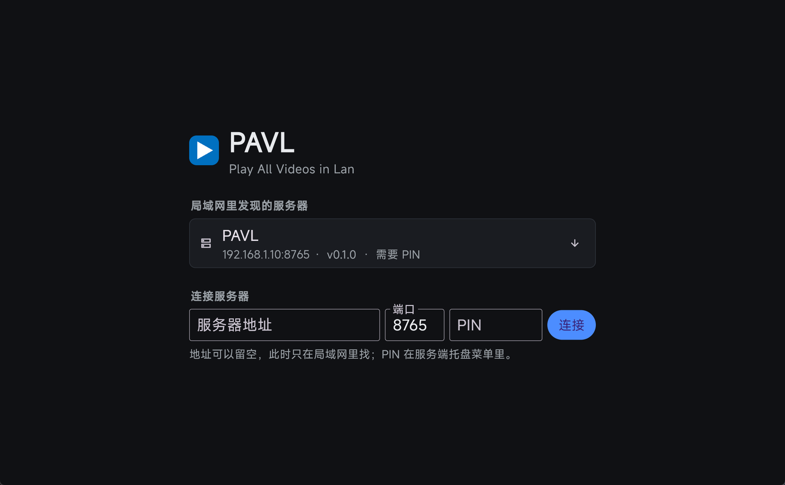
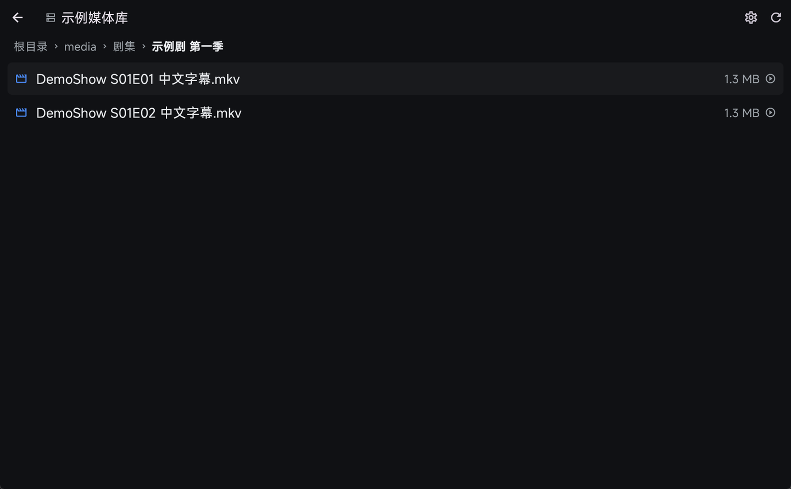
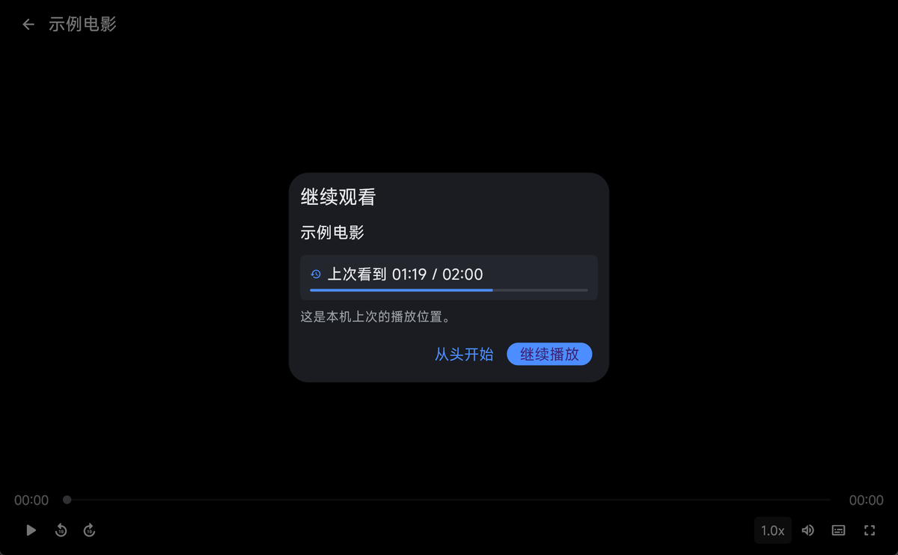

# PAVL · Play All Videos in Lan

English | [简体中文](README.md)

Watch your own video library around the house: a server runs on one Windows machine and shares your
video folders; clients on the same network connect and play. The server never decodes or transcodes
anything — it just serves files over HTTP Range — and all decoding happens on the client. That is why
MKV, HEVC, AV1, ASS subtitles and PGS image subtitles all play as they are.



## What it solves

The usual setup at home is "one machine stores the videos, other devices watch them". Every common
option has its own friction: DLNA stalls when you seek because something has to transcode, SMB support
is uneven on mobile, and cloud-drive style players ignore embedded subtitles.

PAVL splits the problem in two:

* **The server only serves bytes** — it indexes the folders, answers HTTP Range requests, and stores
  playback progress. It never touches the video content, so it fits in a single small executable and
  stays cheap while idle.
* **The client only decodes** — it bundles libmpv, so MKV, HEVC, AV1, rich ASS subtitles and PGS image
  subtitles play directly. The server does no remuxing of any kind.

With that split, the only remaining bottleneck is the network itself: on a gigabit LAN seeking responds
in milliseconds and the server's CPU stays nearly idle.

What it does not do: no transcoding, no download cache, no metadata scraping, no internet exposure.
Which formats play is a property of the client, not of the server.

## Features

| | |
|-|-|
| **Discovery** | UDP broadcast discovery on the LAN; remembers the last address and connects directly first; manual IP entry as a fallback |
| **Pairing** | One-time 6-digit PIN, exchanged for a 32-byte token; later connections are automatic. Paired devices can be reviewed and revoked from the server |
| **Browsing** | Drill down folder by folder with item counts and file sizes; breadcrumbs jump back to any level; folders with no media are hidden |
| **Sorting** | Sorted on the server: folders first, numbers by value (`Episode 2` before `Episode 10`), letters case-insensitive, Chinese characters by pinyin. Size and modified time are also available |
| **Library** | Grouped by folder: a folder row shows up to two levels of directory names plus its episode count, and expands in place; a folder holding one video shows that video directly. Ordered by name, searchable by keyword, paged as you scroll, with recently played on top (items watched to 90% are left out) |
| **Playback** | Play-pause, ±10 s, scrubbing, 0.5x–2.0x speed, volume, fullscreen; the display is kept awake while playing and released on pause or exit |
| **Track selection** | Audio and subtitle tracks listed separately; the choice is remembered per file and restored on reopen. When a track id changes (another episode, a remux, a re-encode) it falls back to the same language or title |
| **Subtitles** | Embedded tracks plus sidecar files in the same folder, matched by base name and episode number first and by similarity as a fallback; ASS styling renders as authored |
| **Progress** | Two modes: this device only, or synced across devices so you can continue on another machine; the list shows progress and percentage |
| **Resume** | Reopening a file offers the previous position: start over or continue; from 90% on a file counts as watched, so no prompt and no entry in recently played |
| **Settings** | A dedicated page with two sections down the left: playback, about. The rail moves to the top when the window narrows |
| **Portable** | Both the server and the Windows client keep data, logs and temporary files in a `PAVL-data/` folder next to the executable, so copying the folder is enough. If the server ends up in a read-only location it falls back to `%APPDATA%\PAVL` |
| **Tray** | The server lives in the notification area; right-click to add or change shared folders, stop sharing one of them, and to read the address and PIN. Changes take effect immediately without a restart |
| **Diagnostics** | Playback failures report a reason and the log location; sensitive fields such as tokens are redacted |

## Screens

| Library | Series and files |
|-|-|
|  |  |

| Playing | Resume prompt |
|-|-|
|  |  |

## Quick start

**Server** (Windows, the machine holding the files)

1. Run `server/pavl.exe`. It moves to the notification area (under the `^` in the taskbar).
2. On first run it asks for a folder to share; you can also pass one:
   `pavl.exe --root "D:\Videos"`.
3. If Windows shows a firewall prompt, allow access.
4. Right-click the tray icon to see the server address and the current PIN.

**Client** (the machine watching)

1. Run `client/pavl_client.exe`.
2. Servers on the LAN appear in the list automatically; otherwise enter the address and port.
3. The first connection asks for the 6-digit PIN shown in the server's tray menu. After pairing it is
   not requested again.

Keyboard controls while playing: `Space` play/pause, `←` `→` seek back/forward 10 seconds,
`↑` `↓` volume ±5, `F` fullscreen, `Esc` leave fullscreen (or go back when not fullscreen).

**Client** (macOS)

1. Drag `PAVL.app` into the Applications folder and open it.
2. The first launch asks whether PAVL may find and connect to devices on your local network.
   **This must be allowed.** Otherwise discovery finds nothing and streaming is blocked. If it was
   denied, re-enable it under System Settings → Privacy & Security → Local Network.
3. After that it behaves exactly like the Windows client.
4. The red close button only hides the window into the Dock; the app keeps running. Quit with `⌘Q`,
   and click the Dock icon to bring the window back.

## How it works

The server depends only on the Dart standard library (`dart:io` / `dart:convert` / `dart:async` /
`dart:math`), plus `lpinyin` for collation, and compiles to a single executable of about 7.5 MB. It
does three things:

* scans the configured media roots and builds a browsable tree plus a library index (results are
  cached and invalidated when the disk changes);
* serves files over HTTP Range, handling first-segment, last-segment, out-of-range, cross-tail and
  no-Range requests correctly;
* stores playback progress and metadata write-backs (duration and codec are probed by the client and
  reported back; the server never parses video).

The client is a Flutter application whose playback core is media_kit wrapping libmpv. Because decoding
is local, whether H.265 or AV1 plays depends on the client's hardware decoding support rather than on
the server; conversely, the server has no notion of "supported formats".

A few deliberate trade-offs:

* **No SMB.** HTTP from the server is enough; the client does not mount a network drive, and FFmpeg's
  SMB backend never enters the dependency tree.
* **No transcoding.** Transcoding is the one part of this design that would burn CPU and make the
  interface slow. Leaving it out is what allows the server to be this small.
* **The PIN is unrelated to system accounts.** A home setup does not need an account system; a one-time
  PIN exchanged for a token is sufficient, and devices are revoked from the server menu.
* **The server does not parse video.** Duration and codec information is written back by a client when
  it opens a file, so files that were never played show their size only.

### Where the data lives

Both sides ask whether the program folder is writable, not whether an installer was used — the server
has only ever been a single executable, so "installed" just means it was put somewhere read-only such
as `Program Files`.

| Form | Criterion | Server data | Client data |
| --- | --- | --- | --- |
| Portable | program folder writable | `<program folder>/PAVL-data/` | `<program folder>/PAVL-data/` |
| Installed | program folder read-only | `%APPDATA%\PAVL` (macOS and Linux fall back to `~/Library/Application Support/PAVL` and `$XDG_CONFIG_HOME/pavl`) | same |

The first time the server starts in portable form it copies `config.json`, `devices.json`,
`progress.json`, `prefs.json` and `meta.json` from `%APPDATA%\PAVL`. Only files that do not exist at
the destination are copied, and the originals are left in place.

A process started by the interpreter (`dart run bin/pavl.dart`) is always treated as installed,
otherwise the configuration would land inside the Dart SDK's `bin/` directory. Set the `PAVL_DATA_DIR`
environment variable to point the data elsewhere for a single run.

### Where track choices are stored

Because a portable bundle is often handed to someone else, the track choice is kept on the client in
`client.json` when the server is portable — storing it on the server would mean choosing subtitles on
the next person's behalf. When the server is installed, the choice goes into `prefs.json` on the server
and is keyed by device id, so several machines can share one server and still keep their own choices.
It is not synced across devices; that is a separate feature.

```json
{
  "<relative path>": {
    "devices": {
      "<device id>": {
        "audio": "2", "audioLang": "zho", "audioTitle": "Mandarin",
        "subtitle": "1", "subtitlePath": null,
        "updatedAt": 1794217636835
      }
    }
  }
}
```

Which of the two applies is decided by the `storage` field of `/api/v1/info` (`portable` or
`installed`). An older server that lacks the field is treated as portable, which matches its previous
behaviour. Settings → Playback holds the “remember track choices” switch; the “Where the config lives”
line under it states which side keeps them, as “Follows this client's folder” for a portable server or
“Follows the <server name> folder” for an installed one.

## Layout

```
PAVL/
├─ server/                     Server (Dart console application)
│  ├─ bin/pavl.dart            Command-line entry point
│  └─ lib/
│     ├─ config.dart           Config storage, media roots
│     ├─ media.dart            Extension kinds, filename parsing
│     ├─ sort_key.dart         The single collation rule (pinyin, numbers, case)
│     ├─ library.dart          Directory tree, library index, cache, progress, metadata, prefs
│     ├─ library_groups.dart   Folder grouping and paging units for the library
│     ├─ auth.dart             PIN pairing, tokens, device management
│     ├─ discovery.dart        UDP broadcast discovery
│     ├─ streaming.dart        HTTP Range file serving
│     ├─ subtitle_match.dart   Sidecar subtitle matching
│     ├─ native_dialogs.dart   Native folder picker and message boxes
│     ├─ tray.dart             Tray icon and menu
│     ├─ tray_icon.dart        Embedded tray icon asset
│     └─ pavl_server.dart      Routing and authentication
├─ client/                     Flutter client (Windows / macOS)
│  ├─ lib/api/                 HTTP client and LAN discovery
│  ├─ lib/store/               Local settings and data directory
│  ├─ lib/player/              Playback controller wrapper
│  ├─ lib/ui/                  Connect, browse, player, settings, pairing
│  ├─ lib/util/                Logging, natural ordering, platform differences
│  ├─ assets/LICENSE.txt       Full license text, bundled so Settings → About → License can show it
│  ├─ assets/fonts/            UI font and its license
│  ├─ windows/                 Windows platform project
│  └─ macos/                   macOS platform project
├─ scripts/                    Branding, build, packaging and UI verification scripts
└─ docs/images/                Documentation screenshots
```

## Building

**Server**

```
cd server
dart pub get
dart compile exe bin/pavl.dart -o ../build/pavl.exe
cd .. && python scripts/embed_icon.py     # attach the application icon
```

`dart compile exe` has no icon option, so the exe it produces carries no icon resources and Explorer
and the taskbar fall back to the generic blank program icon. The tray icon is unaffected, since that
one is drawn at runtime. `embed_icon.py` writes `client/windows/runner/resources/app_icon.ico` into
the exe as `RT_ICON` and `RT_GROUP_ICON` through pywin32 and leaves every existing resource alone. An
exe that already has an icon is skipped, so the script is safe to run repeatedly.
`scripts/package.py --server` calls it automatically before packaging, so packaging scripts do not
need the extra step.

**Client** (Windows)

```
python scripts/setup_media_kit_deps.py    # pre-fetch libmpv and ANGLE
cd client
flutter pub get
flutter build windows --release --dart-define=PAVL_VERSION=0.2.3
```

`setup_media_kit_deps.py` downloads the libmpv and ANGLE prebuilt packages that media_kit needs into the
expected location, so that the CMake build does not have to fetch them itself. Behind a proxy or on a
slow connection this step is what prevents the build from failing with an integrity error.

The version lives in `pubspec.yaml`, but Flutter does not compile it into the binary, so the "about"
section of the settings page gets it through `--dart-define=PAVL_VERSION=x.y.z` at build time. Omitting
the flag does not break the build; the page just falls back to the default value in
`client/lib/util/build_info.dart`.

**Client** (macOS, run on the Mac)

```
cd client
flutter pub get
flutter build macos --release --dart-define=PAVL_VERSION=0.2.3
```

On macOS the libmpv frameworks are fetched by `media_kit_libs_macos_video` during `pod install`, so no
extra script is needed. Recent Xcode releases only accept deployment targets of 12.0 or later (27.2
supports 12.0 through 27.2.x) while the dependency podspecs still declare 10.9, so the `post_install`
hook in `macos/Podfile` raises every pod to 12.0. Do not remove it: without it each `pod install`
writes the old values back and the build fails.

**Packaging**

The server and the clients ship as separate packages.

```
python scripts/package.py --server --zip     # server
python scripts/package.py --portable --zip   # Windows client (portable)
python scripts/package.py --macos --zip      # macOS client
python scripts/package.py --all --zip        # everything buildable on this host
```

Package naming rule:

```
<app>_<platform>_<client|server>[_portable]_<version>
```

* The `portable` segment appears only for portable builds and is omitted for installers. Both the
  Windows server and the Windows client are portable here (unzip and run, delete the folder to
  uninstall), so both carry it; the macOS build is a `.app` you drag into Applications, so it does not.
* Platform is one of `windows`, `macos`, `linux`.

The three packages currently produced:

| Package | Contents |
| --- | --- |
| `PAVL_windows_server_portable_<version>` | `pavl.exe`, a short readme and `LICENSE.txt` |
| `PAVL_windows_client_portable_<version>` | `pavl_client.exe`, runtime DLLs, `data/`, notes and `LICENSE.txt` |
| `PAVL_macos_client_<version>` | `PAVL.app`, installation notes and `LICENSE.txt` |

All three packages carry a copy of `LICENSE.txt`: lpinyin (BSD 2-Clause), the Dart runtime and Flutter
(BSD-3-Clause) and MiSans (Apache 2.0) all require the copyright notice to travel with any
redistribution, and what users receive is the extracted folder, so keeping the file only in the source
repository is not enough.

The `.app` archive has to be produced by `ditto` on macOS; a plain zip loses the symlinks and
executable bits and will not launch after extraction.

## Conventions

* Scripts are Python and UTF-8; build, packaging and UI screenshot helpers all live in `scripts/`.
* Do not batch-edit Dart sources with regular expressions; use exact literal replacements.
* Generated files stay out of the repository: `build/`, `client/build/`, `dist/`, `.dart_tool/`,
  temporary directories.
* Documentation and screenshots never contain a real environment: addresses use examples such as
  `192.168.1.10`, devices are named by platform only, and local paths, accounts and ports appear only
  where the build truly requires them.

## Platform status

| Platform | Status |
|-|-|
| Windows server | ✅ Complete |
| Windows client | ✅ Complete |
| macOS client | ✅ Complete |
| Linux server | Builds; tray and native dialogs missing |
| Android / iOS / Android TV | Not started |
| Apple TV | Out of scope |

The protocol and routes do not depend on Windows; porting the server mainly means replacing the tray
icon and the native dialogs.

## Known limitations

* The server ships for Windows only; on other platforms it builds and runs but has no tray menu.
* The firewall port must be allowed manually; there is no self-check yet.
* The macOS client needs the Local Network permission on first launch. After a denial the system stops
  asking; if a manual broadcast then finds no server, the client falls back to probing the servers it
  has already paired with, and only then points the user to
  System Settings → Privacy & Security → Local Network.
* Poster and synopsis support is exposed by the API but not surfaced in the UI.

## License

The code is original work released under the MIT license; see [LICENSE](LICENSE).

The same text is bundled inside the client as `client/assets/LICENSE.txt`, which is what
Settings → About → License reads and displays, so it does not depend on `LICENSE.txt` still
sitting next to the installed program. `scripts/package.py` verifies the two copies are
byte-identical before packaging.

Third-party components bundled with the client:

* **libmpv** (LGPL-2.1-or-later). The build shipped with the client has its GPL components disabled and
  links libmpv dynamically; `libmpv-2.dll` and its companion libraries under `client/` are this
  component.
* **UI font MiSans**, distributed under the Apache License 2.0. The full variable font `MiSansVF.ttf` is
  bundled without subsetting or modification; the license requires keeping the license and notice files
  with any redistribution, and both are in the repository:
  * `client/assets/fonts/MiSans-LICENSE.txt` — the full Apache License 2.0 text
  * `client/assets/fonts/NOTICE.txt` — font origin, usage and no-modification statement
* **lpinyin** (BSD 2-Clause), used by the server to convert Chinese characters to pinyin for sorting. The
  dictionary is compiled into `pavl.exe` and no external file is loaded at runtime, but redistributing the
  binary still requires including its copyright notice; the full text is in [LICENSE](LICENSE).
* **Dart runtime** (BSD-3-Clause), embedded in the output of `dart compile exe`.
