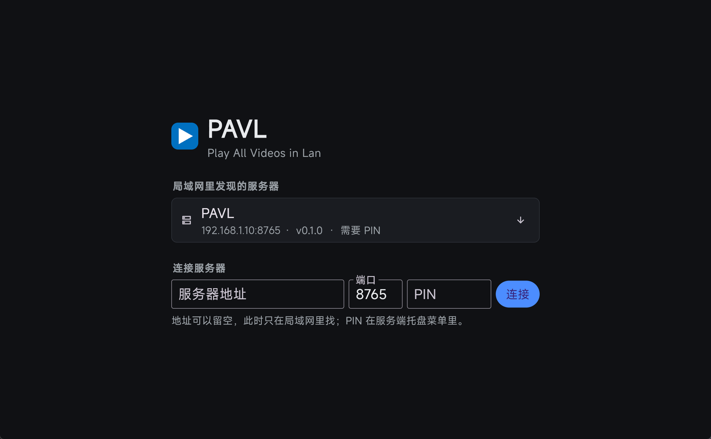
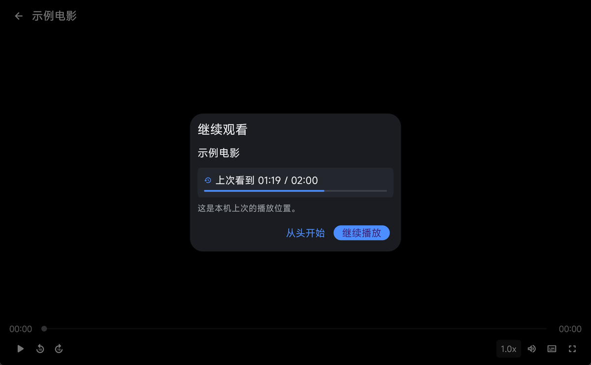

# PAVL · Play All Videos in Lan

[English](README.en.md) | 简体中文

局域网里放视频：一台 Windows 电脑跑服务端，把自己的视频文件夹共享出去；同一网络里的其它
设备用客户端连上看。服务端不解码、不转码，把文件按 HTTP Range 原样发出去，解码全部交给客户端，
所以 MKV / HEVC / AV1 / ASS 字幕 / PGS 图形字幕都能原样播。



## 它解决什么

家用网络里最省事的做法是「一台机器存片，其它设备看」。但常见方案各有各的麻烦：DLNA 拖动进度条
要等转码，SMB 在移动端支持参差，网盘类的播放器又不认内嵌字幕。

PAVL 把这件事拆成两半：

* **服务端只管发文件**——扫描目录建索引、按 Range 发字节、存播放进度。不碰视频内容，所以单文件
  一个小 exe 就够，常驻内存也低。
* **客户端只管解码**——自带 libmpv，MKV、HEVC、AV1、ASS 富文本字幕、PGS 图形字幕直接放，不需要
  服务端做任何转封装。

拆开之后，性能瓶颈只剩网络本身：千兆局域网里拖动进度条是毫秒级响应，服务端 CPU 基本不动。

它不做的：不做转码、不做下载缓存、不做刮削、不做公网访问。片源格式由客户端决定，不由服务端决定。

## 功能

| | |
|-|-|
| **发现** | 局域网 UDP 广播自动发现服务端；记住上次的地址优先直连；也可以手填 IP |
| **配对** | 6 位 PIN 一次性配对，换 32 字节令牌，之后自动登录；服务端可查看并吊销已配对设备 |
| **浏览** | 按目录逐层浏览，显示条目数与文件大小；面包屑可回跳任意一级；没有媒体文件的目录自动隐藏 |
| **排序** | 由服务端统一排序：文件夹在前、数字按数值（`第2集` 在 `第10集` 前）、字母不分大小写、汉字按拼音。也可按大小、修改时间排 |
| **片库** | 跨目录拉平成一张表，按标题排、按关键词搜索、滚动到底自动加载下一页，顶部带最近播放 |
| **播放** | 播放暂停、±10 秒、进度拖拽、0.5x–2.0x 变速、音量、全屏；播放期间阻止系统休眠与熄屏，暂停或退出即释放 |
| **选轨** | 音轨与字幕轨各自列出切换，按文件记住选择，下次打开自动恢复 |
| **字幕** | 内嵌轨与同目录外挂字幕自动匹配，主干名 + 集数优先后按相似度兜底；ASS 富文本样式照常渲染 |
| **进度** | 两种模式：只记本机，或跨设备同步（同一账号在不同机器上接着看）；列表上显示进度与百分比 |
| **续播** | 重新打开时提示上次位置，「从头开始」或「继续播放」 |
| **便携** | Windows 客户端的数据、日志、临时文件都落在 exe 同级的 `PAVL-data/`，换机器拷走即走；macOS 客户端遵循系统惯例放在 `~/Library/Application Support/PAVL` |
| **托盘** | 服务端常驻通知区域，右键可添加 / 更换共享目录、查看地址与 PIN，改完立即生效不用重启 |
| **诊断** | 播放失败时给出原因与日志位置；日志里令牌等敏感字段脱敏 |

## 界面

| 浏览媒体库 | 剧集与文件 |
|-|-|
|  |  |

| 播放 | 续播提示 |
|-|-|
|  |  |

## 快速开始

**服务端**（Windows，放片的机器）

1. 双击 `server/pavl.exe`。程序缩到通知区域（任务栏右下角的 `^` 里）。
2. 首次运行会让你选一个要共享的文件夹；也可以带参数指定：
   `pavl.exe --root "D:\Videos"`。
3. 如果 Windows 弹出防火墙提示，点「允许访问」。
4. 右键托盘图标可以看到服务端地址和当前 PIN。

**客户端**（看片的机器）

1. 双击 `client/pavl_client.exe`。
2. 列表里会自动出现局域网中的服务端；没有的话手填地址与端口。
3. 第一次连需要输入服务端托盘菜单里显示的 6 位 PIN，配对一次后不再询问。

播放时的键盘操作：`空格` 播放 / 暂停，`←` `→` 后退 / 前进 10 秒，`↑` `↓` 音量 ±5，
`F` 全屏，`Esc` 退出全屏（非全屏时返回上一页）。

**macOS 客户端**

1. 把 `PAVL.app` 拖进「应用程序」文件夹，双击运行。
2. 第一次启动时系统会问「是否允许 PAVL 查找并连接本地网络上的设备」，**必须点允许**。
   否则发现不到服务端，拉流也会被拦下。误点了拒绝可以到
   「系统设置 → 隐私与安全性 → 本地网络」重新打开。
3. 之后的使用方式与 Windows 客户端一致。

## 技术要点

服务端只用 Dart 标准库（`dart:io` / `dart:convert` / `dart:async` / `dart:math`），没有第三方
依赖，编译产物是一个 6 MB 左右的单文件 exe。它做三件事：

* 扫描配置里的媒体根目录，建立可浏览的树与全库索引（结果缓存，磁盘变动后重新扫描）；
* 按 HTTP Range 发文件，正确处理首段、末段、越界、跨界与无 Range 五种情形；
* 存取播放进度与元数据回写（时长、编码等由客户端探测后回传，服务端不解析视频）。

客户端是 Flutter 应用，播放内核是 media_kit 封装的 libmpv。因为解码在本地，H.265 / AV1 能不能放
取决于客户端的硬解能力，而不取决于服务端；反过来，服务端也就没有「格式支持」这个概念。

几个刻意的取舍：

* **不用 SMB**。服务端发 HTTP 就够，客户端不需要挂载网络盘，也不必把 FFmpeg 的 SMB 后端链进来。
* **不做转码**。转码是这套方案里唯一会把 CPU 吃掉、把界面拖慢的环节，去掉它之后服务端才可能这么小。
* **PIN 与系统账号无关**。家用场景不需要账号体系，一次性 PIN 换令牌即可，吊销设备在服务端菜单里。
* **服务端不解析视频**。时长和编码信息由播放过的客户端在打开时回写，没播过的文件就显示大小。

## 目录

```
PAVL/
├─ server/                     服务端（Dart 控制台程序）
│  ├─ bin/pavl.dart            命令行入口
│  └─ lib/
│     ├─ config.dart           配置读写、媒体根目录
│     ├─ media.dart            扩展名识别、文件名解析
│     ├─ sort_key.dart         全项目唯一的排序规则（拼音、数字、大小写）
│     ├─ library.dart          目录树、全库索引、缓存、进度与元数据
│     ├─ auth.dart             PIN 配对、令牌、设备管理
│     ├─ discovery.dart        UDP 广播发现
│     ├─ streaming.dart        HTTP Range 发文件
│     ├─ subtitle_match.dart   外挂字幕匹配
│     ├─ native_dialogs.dart   原生选择框与消息框
│     ├─ tray.dart             托盘图标与菜单
│     ├─ tray_icon.dart        内嵌的托盘图标资源
│     └─ pavl_server.dart      路由与鉴权
├─ client/                     Flutter 客户端（Windows / macOS）
│  ├─ lib/api/                 HTTP 客户端与局域网发现
│  ├─ lib/store/               本地配置与数据目录
│  ├─ lib/player/              播放控制封装
│  ├─ lib/ui/                  连接、浏览、片库、播放、设置、配对
│  ├─ lib/util/                日志、平台差异
│  ├─ assets/fonts/            界面字体与许可
│  ├─ windows/                 Windows 平台工程
│  └─ macos/                   macOS 平台工程
├─ scripts/                   构建、打包与界面验证脚本
└─ docs/images/               文档截图
```

## 构建

**服务端**

```
cd server
dart pub get
dart compile exe bin/pavl.dart -o ../build/pavl.exe
```

**客户端**（Windows）

```
python scripts/setup_media_kit_deps.py    # 预置 libmpv 与 ANGLE
cd client
flutter pub get
flutter build windows --release
```

`setup_media_kit_deps.py` 会把 media_kit 需要的 libmpv / ANGLE 预编译包下载到指定位置，避免
CMake 在构建时联网下载失败。国内网络下这一步尤其必要。

**客户端**（macOS，在 Mac 上执行）

```
cd client
flutter pub get
flutter build macos --release
```

macOS 上 libmpv 由 `media_kit_libs_macos_video` 在 `pod install` 阶段自动下载，不需要额外脚本。
新版 Xcode 只接受 12.0 及以上的部署目标（实测 27.2 支持区间为 12.0 至 27.2.x），而依赖的
podspec 仍写着 10.9，`macos/Podfile` 里的 `post_install` 会逐 target 覆盖成 12.0——这一项不要删，
否则每次 `pod install` 都会把旧值写回去并导致编译失败。

**打包**

服务端与客户端分开发布，按需下载。

```
python scripts/package.py --server --zip     # 服务端
python scripts/package.py --portable --zip   # Windows 客户端（便携版）
python scripts/package.py --macos --zip      # macOS 客户端
python scripts/package.py --all --zip        # 当前平台上能打的全打
```

产物命名规则：

```
软件名_平台名_客户端/服务端_便携版_版本号
```

* 便携版这一段只在便携形态上出现，安装版省略。Windows 的服务端与客户端都是便携形态
  （解压即用、删目录即卸载），所以两者都带 `portable`；macOS 是一个拖进「应用程序」的
  `.app`，不带。
* 平台名取 `windows` / `macos` / `linux`。

当前三个包：

| 包名 | 内容 |
| --- | --- |
| `PAVL_windows_server_portable_<版本>` | `pavl.exe` 与运行说明 |
| `PAVL_windows_client_portable_<版本>` | `pavl_client.exe`、运行时 DLL 与 `data/` |
| `PAVL_macos_client_<版本>` | `PAVL.app` 与安装说明 |

`.app` 的压缩必须在 macOS 上用 `ditto` 完成，普通 zip 会丢掉符号链接与可执行权限，解压后起不来。

## 开发约定

* 脚本一律 Python，UTF-8 编码；构建、打包、界面截图脚本都放 `scripts/`。
* Dart 源码不要用正则批量替换，改用精确字面量替换，避免误伤。
* 生成物不入库：`build/`、`client/build/`、`dist/`、`.dart_tool/`、临时目录。
* 文档与截图不写真实环境：地址用 `192.168.1.10` 这类示例，设备只写平台名；本地路径、账号、
  端口等除说明构建所必需外不出现。

## 平台状态

| 平台 | 状态 |
|-|-|
| Windows 服务端 | ✅ 完整可用 |
| Windows 客户端 | ✅ 完整可用 |
| macOS 客户端 | ✅ 完整可用 |
| Linux 服务端 | 可编译，缺托盘与原生选择框 |
| Android / iOS / Android TV | 未开始 |
| Apple TV | 不做 |

服务端的协议与路由本身不依赖 Windows，移植到其它平台主要工作在于托盘与原生选择框的替代实现。

## 已知限制

* 服务端只有 Windows 版本；在其它平台可以编译运行，但缺少托盘菜单。
* 需要用户自行放行防火墙端口，暂未做自检提示。
* macOS 客户端首次运行需要同意「本地网络」权限。误点拒绝后系统不再询问，此时客户端手动广播一轮
  若一台服务器都没应答，会提示去「系统设置 → 隐私与安全性 → 本地网络」检查。
* 文件夹刮削（海报、简介）的接口已预留，界面未做。

## 许可

代码为本项目原创，按 MIT 许可证发布，见 [LICENSE](LICENSE)。

客户端内含的第三方组件：

* **libmpv**（LGPL-2.1-or-later）。随客户端分发的构建已关闭 GPL 组件，通过动态链接使用；
  `client/` 目录下的 `libmpv-2.dll` 与相关动态库即为此组件。
* **界面字体 MiSans**，按 Apache License 2.0 随程序分发。打包的是完整可变字体
  `MiSansVF.ttf`，未做子集化或改刻；许可证要求再分发时保留许可与声明，两者都在仓库里：
  * `client/assets/fonts/MiSans-LICENSE.txt` —— Apache License 2.0 全文
  * `client/assets/fonts/NOTICE.txt` —— 字体来源、用途与未修改声明
